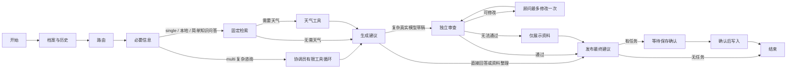

# 从一条咨询理解代码

建议先演示一遍，再按下面顺序读。第一轮掌握关键路径即可。

## 1. 从页面发出请求

`frontend/src/App.vue` 的 `send` 创建会话、添加用户消息，然后调用 `api.ts` 的 `stream`。`stream` 用 Fetch 读取 SSE，每遇到完整帧解析一个事件。

主要事件：`status` 表示实际节点；`text_delta` 是直接回答时真实模型 JSON 中解码出的回答增量；`advice` 是验证后的完整建议；`awaiting` 表示需要补充/确认；`plan_saved` 表示数据库写入成功；`done` 表示这轮处理结束。复杂场景草稿在审查前不展示，`model_token` 只记录实际首个回答 token 的时间，不包含内部思维链。

本地资料演示直接返回 advice，不伪造模型 token 或百分比。

## 2. API 先校验用户和会话

`backend/app/main.py` 的 `send_message` 通过 `current_user` 获取服务端用户，使用 `owned` 检查会话 owner。同一会话有并发锁，正在执行时第二个请求得到 409。

先读取 checkpoint 判断当前是否等待补充或确认，再持久保存用户消息并准备图输入。如果正在等待补充，用 `Command(resume=content)` 继续；如果已有待确认草稿但用户提出新问题，先跳过该草稿，再启动下一轮。

客户端传 session_id，不能自由指定 user_id。身份不会交给模型决定。

## 3. 看 LangGraph 的节点和连线

打开 `agent.py`，先看文件底部 `build_graph` 中的 add_node / add_edge / add_conditional_edges，再回看节点函数。

`State` 保存这一轮问题、档案、历史、工具结果、候选草稿、审查意见、修改次数和 trace。route 决定场景；复杂多角色路径的 coordinate 通过真正的 tools/tool_calls 决定读取哪些工具以及下一轮调用，review/revise 用条件边限制修正次数。publish 后才产生可确认建议。

## 4. 理解 interrupt

`clarify` 判断是否缺少当前问题需要的字段，调用 `interrupt`。它不是等待某个 Python input，而是暂停图、保存状态并把问题交给前端。

下次请求用 `Command(resume=...)` 回到这个节点。LangGraph 会重新执行被中断节点，因此中断前避免执行业务写入；本项目的计划写入位于确认返回后，并额外使用唯一 draft_id。

刷新后能继续的是已经保存的追问/确认状态。未完成的外部 API 调用不具有自动“恰好一次”的保证。

## 5. 检索不是模型自由编来源

`rag.py` 首先用 jieba 分词；BM25 按词项相关性排名。本地 TF-IDF 是对照基线。真实 embedding 开启后，向量与 BM25 两路召回用 RRF 融合。

RRF 不要求两个分数具有相同量纲：每路按排名贡献 `1 / (60 + rank + 1)`。资料内容、原文地址、小节和地区一起返回。

`generate` 检查 citation_ids 是否来自此次候选集合，无效引用触发回退。这个校验能防止编造引用 ID，但不能保证所有建议都被引用充分支持，后者仍需要内容评测。

## 6. 真实模型与本地演示

`llm.py` 的 `route_model` 请求结构化路由结果；`generate_advice` 请求流式 JSON，逐步解码 answer 字段，最终用 Advice 校验整个对象。

API 超时、JSON 不合法、日期不合法、引用不合法都有明确处理。失败后返回资料整理并标注回退，不能继续说“真实模型成功”。

`collaboration.py` 的 collect_context 先将工具名称、参数 schema 和协调员提示词交给模型，再执行通过校验的 tool_calls，将含 tool_call_id 的工具结果回传。身份来自服务端 state，工具 schema 不接受 user_id；模型没有数据库写工具。

`review_advice` 使用独立审查提示词和 AdviceReview 结构。审查请求只能看证据、草稿和用户报告，没有协调员工具权限。revise 将具体审查意见交给顾问，第二次仍未通过则降级；审查通过不等于专业认证。

`context_budget.py` 在四类聊天模型请求发送前统一执行预算检查：估算消息和工具定义大小，预留输出与安全余量，筛选可省略的上下文。它只修改调用副本，原始 State/数据库仍保留完整记录。当前问题、澄清、档案和过去用户消息保留；历史任务详情被省略时保留任务标识与状态；审查和修改的引用资料保持完整。工具结果只移除完整记录并标注省略，保留所有 tool_call_id 配对。必要内容仍超限时抛出带 context_budget_exceeded 原因的异常，由现有失败分支降级。估算采用 UTF-8 字节数和协议余量，不是供应商精确分词结果；模型窗口和预算通过 .env.example 中的配置调整。usage.context_budget 记录这次筛选的估算和省略计数。

`agent.py` 的 `local_route` / `local_advice` 是可运行的教学/开发路径。它们不是训练得到的智能模型。

## 7. 计划、日期和反馈

只有用户点击“保存计划”，`confirm` 才创建 Plan / Task。Plan 的 draft_id 唯一，Task 的 plan_id + position 唯一；同一确认重复提交返回同一份计划。

用户可以安排任务日期，提交执行反馈。重复提交相同反馈不会产生重复记录。下一轮 context 节点读取任务与最新反馈，所以回访有真实历史依据。

用户“完成”是用户报告的执行状态，代码不把它解释成已验证的养蜂效果。

## 8. 记忆分三层

- 档案：用户在表单确认保存的城市、阶段、蜂种等。
- 会话状态：本次补充的情况在同一会话可继续使用，不自动变成永久档案。
- 历史事件：计划、任务、执行反馈，记录内容和时间。

profile_record 用于判断档案是否被修改，避免旧会话字段覆盖用户后来的纠正。大量聊天不全部塞入永久事实。

## 建议阅读顺序

1. `agent.py` 的图连线和 State（15 分钟）。
2. `main.py` 的 send_message / run_stream / resume（20 分钟）。
3. `rag.py` 的 search（20 分钟）。
   再看 `collaboration.py` 的 collect_context，跟踪一个工具结果如何返回给模型。
4. `models.py` 与计划写入（15 分钟）。
5. `tests/test_workflow.py` 和 `test_additional.py`，理解失败场景（20 分钟）。

阅读时画出一个例子：用户第一句 → 缺什么 → 哪个节点中断 → 何时恢复 → 哪些工具被调用 → 哪个字段落库。能画清楚这条路径，就有了面试讲解的主线。
