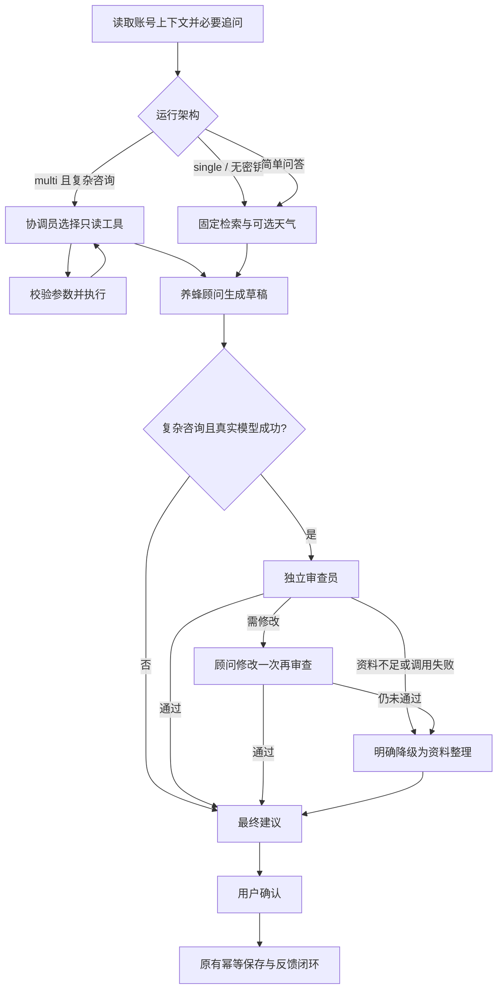

# 轻量多 Agent 改造方案

设计日期：2026-10-11。目标是改善复杂养蜂咨询的工具选择和建议检查，保留可对照的单 Agent 基线。

## 角色与权限

| 角色 | 输入与输出 | 允许操作 |
|---|---|---|
| 协调员 | 问题、必要档案、场景、工具返回；输出原生 tool_calls 或结束信号 | 仅查询档案、资料、天气、近期任务；没有写入工具 |
| 养蜂顾问 | 问题、资料全文与来源、天气、用户报告；输出 Advice 草稿 | 生成结构化建议；无数据库写权限 |
| 审查员 | 草稿、证据、适用条件、已执行任务；输出结构化审查意见 | 提出修改或说明证据不足；不能调用工具或保存计划 |

三个角色可以使用同一个 DeepSeek 模型，通过独立提示词、消息上下文、输出约束和权限形成分工。工具本身不是 Agent；天气工具和检索器不会被包装成额外的 Agent。

## 执行流程

协调最多 3 轮、共 6 次工具请求，同名同参数不重复执行；工具有超时，总协调时间有上限。工具参数不接受用户 ID、数据库语句、地址或任意函数名。未知工具、非法参数、失败和重复调用都作为工具结果返回给模型。即使协调结束但没查资料，系统仍执行必要的依据检索，并在记录中标注由系统补足。

仅在入门、检查、计划、回访或天气相关咨询使用工具协调与审查；纯知识问答走固定检索和顾问直接回答，跳过两个额外阶段以控制延迟。审查提出修改后最多改一次，再审查一次；未通过、资料不足或审查失败则回退为明确标记的资料整理，并不给未通过草稿提供保存入口。

DeepSeek 官方接口默认使用 thinking.type=disabled，避免短结构化角色把输出预算耗在推理上。MODEL_THINKING_ENABLED 可显式开启；其他兼容接口不接收此供应商参数。输出截断和结构校验失败保留 failure_reason，以及供应商已返回的 token 用量，不将失败调用的费用隐藏。

审查中的模型判断不等于领域专家验证，也不能保证消除幻觉。代码仍执行结构与引用 ID 检查；资料、模型能力和样本评测仍是限制。复杂咨询草稿在审查前不展示为最终建议。

## 验收与学习顺序

1. 阅读 agent.py 的状态、条件边和确认节点，再看 collaboration.py 的原生工具循环。
2. 对照 llm.py 的三个角色提示词，理解同一个模型如何承担不同职责。
3. 观察运行记录中的角色、工具、轮次、失败、审查与修改次数。
4. 测试未知工具、跨账号参数、重复调用、工具超时、轮次耗尽、审查失败和修改仍不通过。
5. 用相同问题比较 single 与 multi 的任务完成、引用支持、重复任务、耗时和 token；没有对照结果前不声称多 Agent 效果更好。

配置 AGENT_ARCHITECTURE=single 可以恢复固定流程；默认 multi。无密钥时只执行资料演示，不宣称真实多 Agent 推理。已有档案、计划、反馈和 SQLite checkpoint 沿用，复杂流程新增状态应在每轮请求开始时重置。

## 本次实际验证

43 项自动测试与前端构建通过。DeepSeek 四条同题对照中两种架构各成功 4/4；三个复杂 multi 场景通过审查，真实确认保存和反馈成功。此次 single 平均 5.684 秒、四题共 11,611 tokens，multi 平均 9.292 秒、共 32,503 tokens。复杂协作带来额外成本，简单问答保持直接路径。

这四条是项目自编的功能样本，不能用来声称准确率提升。真实样本没有触发修改分支；一次修改/二次审查及仍不通过的降级由自动测试验证。详见 VERIFICATION.zh-CN.md。
