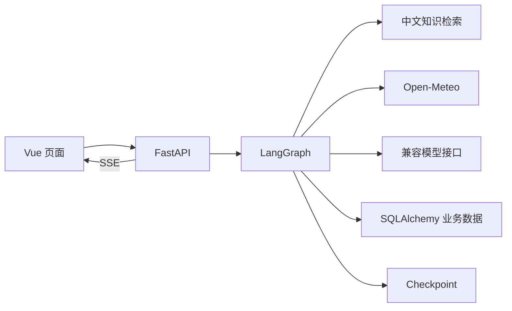

# 蜂伴技术栈与分工

按当前代码整理；DeepSeek 真实联调状态更新于 2026-10-11。

| 层次 | 技术 | 项目作用 | 当前状态 |
|---|---|---|---|
| 页面 | Vue 3、TypeScript、Vite | 咨询、档案、资料、任务与运行记录 | 已运行、类型检查与生产构建 |
| 前端状态 | Pinia | 用户、会话、任务与资料列表 | 已运行 |
| 图标与样式 | Lucide Vue、CSS | 工作台界面与响应式布局 | 已运行 |
| API | Python 3.12、FastAPI、Uvicorn | 请求校验、账号权限、流程入口与静态前端服务 | 已运行 |
| Agent 编排 | LangGraph / StateGraph | 节点、状态、条件边、interrupt/Command；协调、顾问、独立审查及有限修改 | 单流程和多角色路径均有回归测试 |
| 图状态持久化 | AsyncSqliteSaver | 本地 checkpoint、中断与恢复 | 已运行 |
| 模型通信 | HTTPX、OpenAI 兼容协议、DeepSeek | 模型分类、JSON 流式建议生成 | MockTransport 验证；deepseek-flash 三场景及打包服务真实调用通过 |
| 数据约束 | Pydantic / Pydantic Settings | API、结构化输出、日期及配置校验 | 已运行 |
| 中文检索 | jieba、BM25、NumPy / TF-IDF | 分词、词项召回、本地词频向量、RRF 对照与显式季节筛选 | 本地已运行 |
| 语义检索 | embedding API、余弦相似度 | 真实语义向量召回及混合检索 | 已有适配代码；待真实 API 验证 |
| 业务数据 | SQLAlchemy、SQLite、Alembic | 用户、消息、计划、任务、反馈、知识和迁移 | 本地已运行 |
| 可选数据库 | PostgreSQL、pgvector、AsyncPostgresSaver | PostgreSQL 向量查询和图状态持久化 | 有适配与 Docker Compose；尚未本机联调 |
| 身份 | JWT、密码派生、owner 校验 | 账号登录与数据归属校验 | 已验证演示账号隔离 |
| 外部工具 | Open-Meteo | 城市天气、时间和单位 | 真实杭州请求验证及失败测试 |
| 通信 | Fetch + SSE | 节点事件、建议、真实模型文本增量与保存结果 | 已运行 |
| 验证 | pytest、HTTPX MockTransport、固定检索题集 | 权限、中断恢复、幂等、失败协议与检索回归 | 24 测试通过；48 检索题 / 12 规则路由题 |

## 请求路径

模型和检索使用 HTTPX/项目代码接入，没有直接使用 LangChain 的模型、工具或检索封装。route 输出 intent/need_weather，复杂多角色路径由协调员通过原生 tools/tool_calls 在允许的只读工具中选择下一步；有限循环、参数校验、去重和预算位于 collaboration.py。简单问题和 single 基线继续使用固定检索。

审查员使用独立 JSON 上下文与 AdviceReview，顾问最多根据意见修改一次，再次审查不通过则降级。角色可以共用 DeepSeek，无需增加模型供应商、向量库或消息队列。具体架构见 MULTI_AGENT.zh-CN.md。

用户确认才进行业务写入；JWT 和 owner 校验在服务端进行，不由模型判断。运行记录是执行摘要、耗时与实际用量，未要求展示模型内部思维链。

## 建议的学习顺序

先看 Vue 与 FastAPI 之间的一条请求，再学 Python 函数/字典、LangGraph 状态与中断；然后读检索、模型协议和数据保存。SQLite 能支持当前本机演示，PostgreSQL 适配与真正部署需要另外验证。
